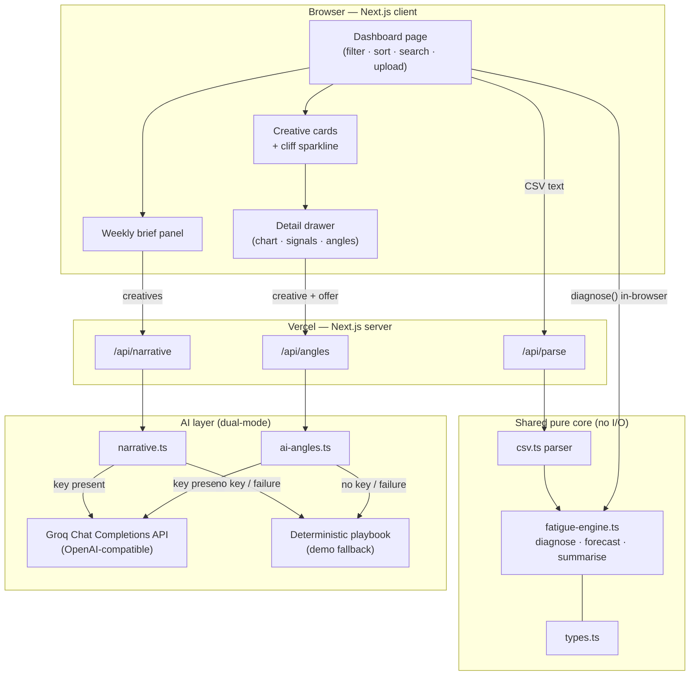
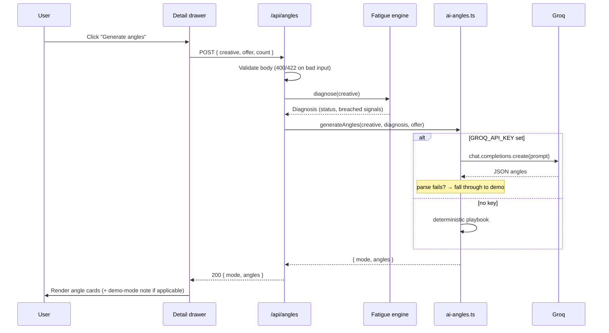
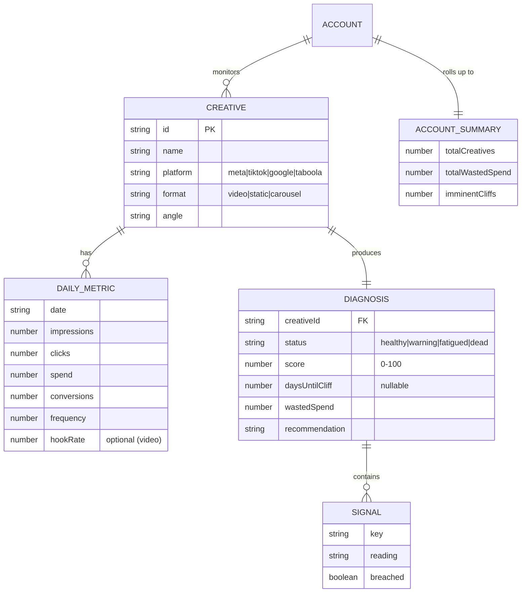
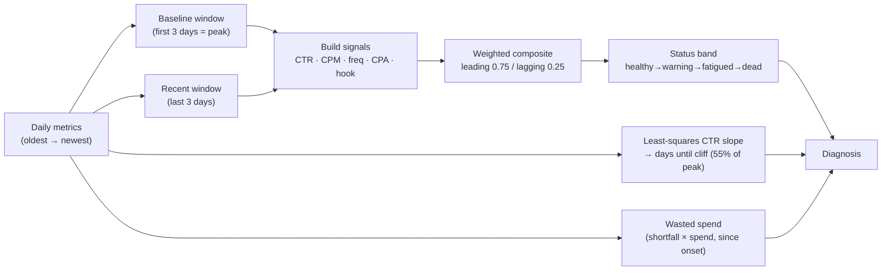

# Architecture

AdSignal is a single Next.js application. The browser renders the dashboard; a
small set of server-side API routes handle CSV parsing and the two AI features
(so the Groq key never reaches the client). The analytical core — the
fatigue engine — is pure TypeScript shared by both sides.

The guiding principle: **keep the graded logic (detection) pure and isolated,
and keep everything I/O-bound (AI calls, parsing) at the edges.** That makes the
core trivially testable and portable to a background worker when live connectors
arrive.

## System architecture

The engine runs **in the browser** for instant diagnosis of the loaded account,
and **on the server** inside the AI routes (to build prompts and ground the
narrative). Same code, both places — the benefit of keeping it pure.

## Request flow — generating refresh angles

The same shape applies to `/api/narrative`. Every AI path has a deterministic
fallback, so a failure never surfaces as a broken state.

## Data model

No database in the MVP; these are the in-memory/transport shapes (see
`src/lib/types.ts`). Shown as relationships for clarity and to describe the
persistence target on the roadmap.

## The fatigue detection pipeline

## Key decisions

- **Pure engine, edges do I/O.** Detection has no network or clock dependency,
  so it's deterministic and unit-tested; the AI/parse routes are the only
  I/O-bound code and they live at the boundary.
- **Dual-mode AI.** Demo-mode fallback makes the product work with zero setup and
  guarantees the app can't break due to an AI provider failure; live mode is a
  superset, not a different path.
- **Groq via OpenAI-compatible API.** The `openai` npm package is pointed at
  Groq's base URL (`https://api.groq.com/openai/v1`). Model is configurable via
  `GROQ_MODEL` env var; default is `llama-3.3-70b-versatile`.
- **No DB in the MVP.** Fixture + CSV upload cover the demo; persistence is the
  first roadmap item, not an oversight.
- **Explainable forecast.** A visible linear CTR slope beats an opaque model for
  a tool whose entire value proposition is *earning the buyer's trust to act early*.
